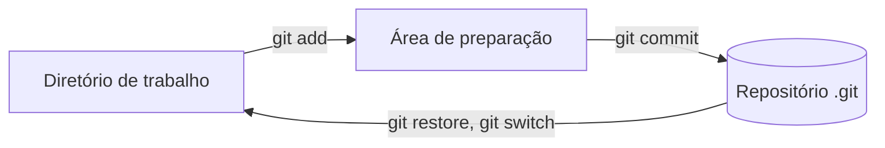

# 01. Fundamentos de Git

Todo mundo já viu uma pasta com `trabalho_final.docx`, `trabalho_final_v2.docx` e `trabalho_final_AGORA_VAI.docx`. É versionamento feito na mão, e ele falha por três motivos. Ninguém sabe qual arquivo é o certo, ninguém sabe o que mudou de uma versão para a outra e, quando duas pessoas editam ao mesmo tempo, alguém perde trabalho. Um sistema de controle de versão resolve exatamente esses três problemas, e o Git é o mais usado deles.

## O que um sistema de controle de versão faz

Ele registra quem mudou o quê, quando e por quê, e permite voltar a qualquer ponto dessa história. Na prática, isso se traduz em cinco capacidades.

| Capacidade | No dia a dia |
| --- | --- |
| Histórico | Cada mudança vira um registro com autor, data e mensagem |
| Volta no tempo | Dá para ver ou restaurar o projeto como estava ontem ou meses atrás |
| Comparação | Mostra, linha a linha, o que mudou entre duas versões |
| Trabalho paralelo | Várias pessoas mexem no mesmo projeto sem sobrescrever o trabalho umas das outras |
| Rastreabilidade | Liga a mudança ao motivo dela, como uma issue ou um bug |

Versionar, portanto, não é guardar cópias. É guardar a história do projeto junto com o motivo de cada mudança.

## Distribuído, e por que isso importa

Os primeiros sistemas guardavam a história num servidor central, e cada pessoa baixava só a versão atual dos arquivos. Se o servidor caísse, ninguém conseguia registrar nada. O Git é distribuído, o que significa que cada cópia do repositório tem a história inteira. Dá para commitar sem internet, criar branch no avião e, se o servidor sumir, qualquer cópia recente serve de backup.

O Git foi criado em 2005 por Linus Torvalds para versionar o kernel do Linux. Por isso ele foi desenhado para ser rápido com muitos arquivos, aguentar muita gente em paralelo e detectar qualquer corrupção da história, que é o motivo de tudo no Git ser identificado por um hash.

## Git não é GitHub

Esta é a confusão número um de quem começa, e vale resolver logo.

| Nome | O que é |
| --- | --- |
| Git | Programa que roda na sua máquina e versiona os arquivos |
| GitHub | Serviço na nuvem que hospeda repositórios Git e acrescenta colaboração (Pull Request, issues, Actions) |
| GitLab, Bitbucket, Azure Repos | Outros serviços de hospedagem, com a mesma ideia |
| GitHub Desktop, extensão Git do VS Code | Interfaces gráficas que chamam o Git por baixo |

O Git funciona sem o GitHub, mas o GitHub não funciona sem o Git. Tudo que este guia ensina sobre commit, branch e merge vale igual em qualquer plataforma. O que muda entre elas é a camada de colaboração.

## As três áreas

O modelo mental mais útil do Git é pensar em três lugares por onde um arquivo passa.

| Área | Também chamada de | O que guarda |
| --- | --- | --- |
| Diretório de trabalho | working directory | Os arquivos como estão agora no seu editor |
| Área de preparação | staging area, index | O que vai entrar na próxima foto |
| Repositório | a pasta `.git` | Todas as fotos já tiradas, com a história completa |



A área de preparação existe para você escolher o que vai em cada commit. Se você mexeu em cinco arquivos, mas só dois fazem parte da mesma mudança, adiciona só esses dois e commita. Os outros três ficam para o próximo commit.

## Commit é uma foto

Um commit é uma foto do projeto inteiro num momento, acompanhada de autor, data, mensagem e um ponteiro para a foto anterior. Encadeados, os commits formam a história.

Tudo que o Git guarda é identificado por um SHA, um código de 40 caracteres calculado a partir dos dados guardados. Se uma vírgula muda, o SHA muda. Na prática, você vê só os primeiros sete caracteres, como `f961db8`.

O jeito mais fácil de ver isso é com o conteúdo de um arquivo, que o Git guarda como um objeto chamado blob. O comando abaixo calcula o SHA do blob de um texto.

```console
$ echo "Olá, Git" | git hash-object --stdin
b597ca532ce23883a4f9db0481faf910746e352a
```

Rode esse comando no seu computador e compare. O resultado é o mesmo, porque o SHA de um blob depende só do conteúdo.

Com o commit é diferente. O SHA de um commit é calculado a partir do conteúdo do projeto e também do autor, da data, da mensagem e do commit anterior (o pai). Por isso dois commits com exatamente os mesmos arquivos, feitos por pessoas diferentes ou em momentos diferentes, têm SHAs diferentes. E é também por isso que alterar um commit antigo muda o SHA dele e de todos os que vêm depois.

## HEAD e branch, em uma frase cada

Uma branch é um nome que aponta para um commit. Quando você commita, a branch anda para o commit novo. O `HEAD` é o marcador de "onde você está agora", e normalmente aponta para a branch em que você está trabalhando. O [próximo arquivo](02-branches-pr-e-merge.md) explora isso com calma.

## Configuração inicial

Faça isto uma vez em cada computador. O nome e o e-mail aparecem em todo commit que você criar.

```bash
git config --global user.name "Seu Nome"
git config --global user.email "voce@exemplo.com"
git config --global init.defaultBranch main
```

Se você vai usar o GitHub, use o mesmo e-mail cadastrado na sua conta, ou o endereço `noreply` que o GitHub oferece nas configurações de e-mail, para não expor o seu e-mail pessoal nos commits públicos.

Para conferir o que está configurado e de qual arquivo veio cada valor, use `git config --list --show-origin`.

## O ciclo básico, com saída real

Os hashes das saídas abaixo vão ser diferentes na sua máquina.

```console
$ git init -b main projeto
Initialized empty Git repository in .../projeto/.git/
$ cd projeto
$ echo "# Projeto de exemplo" > README.md
$ git status -s
?? README.md
$ git add README.md
$ git status -s
A  README.md
$ git commit -m "docs: cria o README"
[main (root-commit) ee92cbc] docs: cria o README
 1 file changed, 1 insertion(+)
 create mode 100644 README.md
```

Os dois sinais do `git status -s` contam a história do arquivo. O `??` quer dizer que o Git está vendo o arquivo, mas ainda não o acompanha. O `A` quer dizer que ele foi adicionado à área de preparação e vai entrar no próximo commit.

## O `.gitignore` salva segredos

Alguns arquivos nunca devem entrar no repositório. Senhas, tokens, arquivos `.env`, pastas de dependências e arquivos gerados pelo build são os exemplos clássicos. O `.gitignore` é a lista desses arquivos, e o Git passa a fingir que eles não existem.

Continuando no mesmo repositório, crie um arquivo de configuração e um `.env` com uma senha de mentira.

```console
$ printf 'PROJETO=exemplo\nTEMPO_LIMITE=30\nUNIDADE=segundos\n' > config.txt
$ echo "SENHA=nao-commite-isso" > .env
$ git status -s
?? .env
?? config.txt
$ printf '.env\n' > .gitignore
$ git status -s
?? .gitignore
?? config.txt
$ git add .
$ git commit -m "chore: adiciona config e .gitignore"
[main f961db8] chore: adiciona config e .gitignore
 2 files changed, 4 insertions(+)
 create mode 100644 .gitignore
 create mode 100644 config.txt
```

Repare que o `.env` sumiu da lista depois de entrar no `.gitignore`, e por isso nem o `git add .` o levou para o commit. Só que o `.gitignore` não desfaz o passado. Se um arquivo já foi commitado, colocá-lo no `.gitignore` não o tira da história. Por isso o `.gitignore` deve existir antes do primeiro commit.

## Vendo o que mudou

Agora troque `TEMPO_LIMITE=30` por `TEMPO_LIMITE=60` no `config.txt`. O `git diff` mostra o que mudou e ainda não foi adicionado, e o `git diff --staged` mostra o que já está preparado para o commit.

```console
$ git diff
diff --git a/config.txt b/config.txt
index 820b1f8..c770aa9 100644
--- a/config.txt
+++ b/config.txt
@@ -1,3 +1,3 @@
 PROJETO=exemplo
-TEMPO_LIMITE=30
+TEMPO_LIMITE=60
 UNIDADE=segundos
$ git add config.txt
$ git diff
$ git diff --staged
diff --git a/config.txt b/config.txt
index 820b1f8..c770aa9 100644
--- a/config.txt
+++ b/config.txt
@@ -1,3 +1,3 @@
 PROJETO=exemplo
-TEMPO_LIMITE=30
+TEMPO_LIMITE=60
 UNIDADE=segundos
```

A linha com `-` é como estava e a linha com `+` é como ficou. As linhas sem sinal são contexto, para você se localizar. Depois do `git add`, o `git diff` fica vazio e a mudança passa a aparecer no `git diff --staged`.

> [!WARNING]
> Se uma senha ou token chegou a ser commitado e enviado, apagar o arquivo no commit seguinte não resolve, porque ele continua nos commits anteriores. O primeiro passo é trocar a senha ou revogar o token. Só depois vale limpar o código.

## Boas mensagens de commit

A mensagem é para quem vai ler a história daqui a seis meses, inclusive você. Ela deve dizer o que mudou e, quando não for óbvio, por quê. Uma convenção bastante usada é a Conventional Commits, que começa a mensagem com um tipo.

```text
<tipo>(<escopo opcional>): <descrição curta no imperativo>

feat: adiciona exportação em CSV
fix(login): corrige erro ao entrar com e-mail em maiúsculas
docs: explica como rodar os testes
```

Os tipos mais comuns são `feat` (funcionalidade nova), `fix` (correção), `docs` (documentação), `refactor` (reorganização sem mudar comportamento), `test`, `ci` e `chore` (manutenção). A convenção não é obrigatória, mas deixa o histórico legível e permite gerar changelog automaticamente.

## Exercícios

1. Num repositório de teste, crie um arquivo, rode `git status -s`, adicione, rode de novo, edite mais uma vez e rode uma terceira vez. Que sinais aparecem em cada momento?
2. Por que o `.gitignore` não protege um arquivo que já foi commitado?
3. Um colega diz que "subiu no Git". O que ele provavelmente fez, e qual seria o termo mais preciso?

<details>
<summary>Respostas</summary>

1. Primeiro `??` (não rastreado), depois `A` (adicionado) e por fim `AM` (adicionado e modificado de novo). Nesse último estado, o commit levaria só a versão que estava no momento do `git add`.
2. Porque o `.gitignore` só diz ao Git para não começar a acompanhar um arquivo. O que já está na história continua lá. Para parar de acompanhar, é preciso `git rm --cached arquivo` e um commit, e mesmo assim os commits antigos ainda guardam o conteúdo.
3. Ele provavelmente commitou e enviou para o GitHub. O termo preciso é `git push` para o remoto. Commit e push são passos diferentes, e confundir os dois é o que leva ao "commitei mas sumiu".

</details>

Próximo arquivo, [02. Branches, PR e merge](02-branches-pr-e-merge.md).
