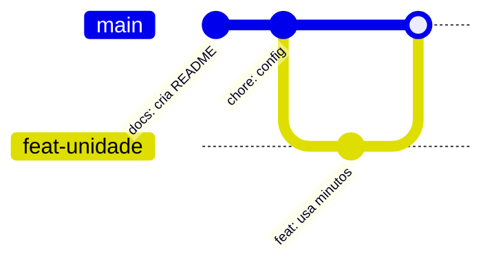
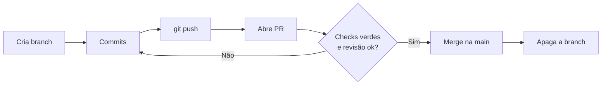

# 02. Branches, Pull Request e merge

Branch é o recurso que permite trabalhar em várias coisas ao mesmo tempo sem uma atrapalhar a outra. No Git ela é barata, então o costume é abrir uma branch para cada tarefa, por menor que seja, e juntá-la de volta quando a tarefa termina. Este arquivo mostra o que é uma branch por dentro, como juntar branches, o que fazer quando dá conflito e como o Pull Request organiza tudo isso no GitHub.

## Branch é um ponteiro, não uma cópia

Uma branch é só um nome que aponta para um commit. Criar uma branch não copia arquivo nenhum, apenas cria um nome novo apontando para o commit atual. Quando você commita, a branch em que você está anda para o commit novo, e as outras ficam onde estavam.



Os comandos do dia a dia são poucos.

```bash
git branch                 # lista as branches locais, com * na atual
git switch -c feat/nome    # cria a branch e já entra nela
git switch main            # troca de branch
git switch -               # volta para a branch anterior
git branch -d feat/nome    # apaga uma branch que já foi integrada
```

O `git switch` é o comando moderno para trocar de branch. Você ainda vai ver `git checkout` em muitos tutoriais, que faz a mesma coisa e mais algumas, por isso confunde mais.

## Dois jeitos de juntar, fast-forward e merge de três vias

Quando a `main` não andou desde que a branch foi criada, o Git só precisa mover o ponteiro da `main` para frente. Isso é o fast-forward, e nenhum commit novo é criado.

```console
$ git merge feat/unidade
Updating 7a3da53..4950ea5
Fast-forward
 config.txt | 2 +-
 1 file changed, 1 insertion(+), 1 deletion(-)
```

Quando as duas branches andaram, o Git compara as duas pontas com o ancestral comum e cria um commit de merge, que tem dois pais. Esse é o merge de três vias. Se as mudanças mexeram em lugares diferentes, ele junta sozinho. Se mexeram na mesma linha de formas diferentes, aparece um conflito.

## Conflito é uma pergunta, não um erro

O conflito acontece quando o Git não sabe qual de duas versões deve valer. Ele não escolhe por você, então marca o trecho e para. No exemplo abaixo, uma branch mudou o tempo limite para 90 e outra para 45.

```console
$ git merge feat/b
Auto-merging config.txt
CONFLICT (content): Merge conflict in config.txt
Automatic merge failed; fix conflicts and then commit the result.

$ cat config.txt
PROJETO=exemplo
<<<<<<< HEAD
TEMPO_LIMITE=90
=======
TEMPO_LIMITE=45
>>>>>>> feat/b
UNIDADE=minutos
```

Entre `<<<<<<< HEAD` e `=======` está a versão da branch em que você está. Entre `=======` e `>>>>>>> feat/b` está a versão que está chegando. Para resolver, siga quatro passos.

1. Abra o arquivo e decida o conteúdo final. Pode ser uma das versões, as duas ou uma terceira.
2. Apague as três linhas de marcadores.
3. Rode `git add config.txt` para dizer ao Git que o conflito foi resolvido.
4. Rode `git commit` para concluir o merge.

Se você se perdeu no meio do caminho, `git merge --abort` desfaz a tentativa e devolve tudo como estava antes do merge. E para listar os arquivos que ainda estão em conflito, use `git diff --name-only --diff-filter=U`.

O ponto mais importante sobre conflito é que ele quase sempre é uma pergunta de negócio. Saber se o limite deve ser 90 ou 45 não é assunto do Git, é assunto do time. Conflito frequente e grande costuma ser sinal de que as branches ficam tempo demais separadas.

## O Pull Request

No GitHub, a forma de pedir para juntar uma branch em outra é o Pull Request, ou PR. Ele é ao mesmo tempo um pedido de merge, um lugar de conversa e um ponto de controle. É no PR que alguém revisa o código, comenta linhas específicas e sugere mudanças. Também é ali que aparecem os checks do GitHub Actions, com o verde e o vermelho que a prática vai mostrar.



Um bom PR tem quatro características.

| Característica | Por quê |
| --- | --- |
| Pequeno | PR de 50 linhas é revisado de verdade. PR de 2.000 linhas é aprovado sem leitura |
| Um assunto só | Misturar correção com refatoração esconde o que mudou |
| Título claro | O título costuma virar a mensagem do commit final |
| Descrição com o porquê e como testar | Quem revisa não estava na sua cabeça quando você escreveu |

Também dá para abrir o PR como rascunho (draft), que sinaliza "ainda estou trabalhando, mas já quero que vejam". Ele não pode ser mesclado enquanto não for marcado como pronto.

## Os três botões de merge do GitHub

Na hora de mesclar um PR, o GitHub oferece três opções, e cada uma deixa a história de um jeito.

| Opção | O que faz | Resultado na `main` |
| --- | --- | --- |
| Create a merge commit | Merge de três vias, com commit de merge | Todos os commits da branch mais um commit de merge |
| Squash and merge | Junta todos os commits da branch em um só | Um commit por PR, com o título do PR |
| Rebase and merge | Reaplica os commits da branch em cima da `main` | Os commits da branch, em linha reta, sem commit de merge |

Não existe opção certa para todo projeto. Times pequenos costumam gostar do squash, porque a `main` fica com um commit por funcionalidade. O importante é o time combinar e, se quiser, desligar as opções que não usa nas configurações do repositório.

## Fluxos de trabalho

Um fluxo de trabalho (branching workflow) é o combinado do time sobre quais branches existem e como o código anda entre elas. Os três mais conhecidos são estes.

| Fluxo | Como funciona | Quando faz sentido |
| --- | --- | --- |
| GitHub Flow | Só a `main` é permanente. Cada tarefa vira branch, PR e merge | Times pequenos, entrega contínua, a maioria dos projetos |
| Git Flow | `main` para versões publicadas, `develop` para integração, mais branches de feature, release e hotfix | Software com versões numeradas e ciclo de release |
| Trunk-based | Todo mundo integra na `main` várias vezes por dia, com branches de horas | Times maduros, com testes automatizados fortes |

Para começar, o GitHub Flow é o mais simples e é o que a prática deste repositório usa. Uma branch por tarefa, um PR por branch, CI verde antes do merge e branch apagada depois.

Um padrão de nomes ajuda a entender a lista de branches de relance. Um formato comum é `tipo/descricao-curta`, como `feat/exportar-csv`, `fix/login-maiusculas` ou `docs/readme`.

## Exercícios

1. Você criou `feat/a` a partir da `main`, fez dois commits e ninguém mexeu na `main`. O merge vai ser fast-forward ou de três vias?
2. No meio de um conflito, você percebeu que não sabe qual versão manter. Qual comando devolve tudo como estava antes do merge?
3. Por que PR pequeno é revisado melhor que PR grande?

<details>
<summary>Respostas</summary>

1. Fast-forward. Como a `main` não andou, basta mover o ponteiro dela para o último commit de `feat/a`.
2. `git merge --abort`.
3. Porque cabe na cabeça de quem revisa. Num PR pequeno é possível entender cada linha e o motivo dela. Num PR enorme, a revisão vira uma olhada por cima, e os problemas passam.

</details>

Próximo arquivo, [03. GitHub](03-github.md).
