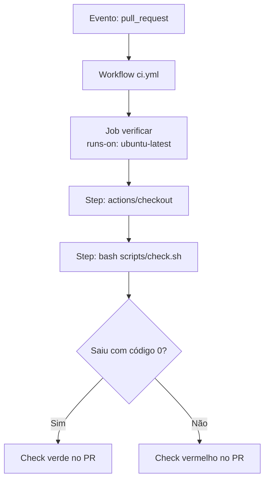

# 04. GitHub Actions, os conceitos

O GitHub Actions é o serviço de automação embutido no GitHub. Ele executa tarefas em resposta a acontecimentos do repositório, como um push, a abertura de um PR, um horário marcado ou o clique num botão. O uso mais comum é a integração contínua, que confere automaticamente cada mudança antes de ela entrar na branch principal. Mas dá para automatizar quase qualquer coisa que se faria num terminal, como gerar um relatório, publicar um site ou fechar issues antigas.

## CI e CD em uma frase cada

Integração contínua (CI, de continuous integration) é integrar o trabalho de todos com frequência, com cada integração conferida automaticamente por build e testes. Entrega contínua (CD, de continuous delivery) é manter o sistema sempre em condição de ser publicado, e implantação contínua (continuous deployment) é publicar automaticamente cada mudança que passa pelo CI.

O ganho do CI é transformar regra lembrada em regra executada. "Rode os testes antes de mesclar" depende da memória de cada pessoa. Um check obrigatório no PR não depende.

## O vocabulário em uma tabela

Seis termos explicam qualquer workflow.

| Termo | O que é | Analogia |
| --- | --- | --- |
| Workflow | Um arquivo YAML em `.github/workflows/` que descreve uma automação | Uma receita |
| Evento | O que dispara o workflow (`push`, `pull_request`, `schedule`, `workflow_dispatch`) | O motivo para começar a cozinhar |
| Job | Um conjunto de passos que roda numa mesma máquina | Uma etapa da receita, numa bancada |
| Step | Um passo do job, que é um comando de shell (`run`) ou uma action (`uses`) | Uma instrução da etapa |
| Runner | A máquina que executa o job, hospedada pelo GitHub ou própria | A bancada |
| Action | Um passo reutilizável publicado por alguém, como `actions/checkout` | Um utensílio pronto |



Três detalhes sobre esse desenho costumam surpreender. Cada job roda numa máquina nova e limpa, que é descartada no fim. Jobs do mesmo workflow rodam em paralelo, a menos que você crie dependência entre eles com `needs`. E o que decide se um step passou ou falhou é o código de saída do comando, em que zero significa sucesso e qualquer outro valor significa falha.

## Eventos mais usados

| Evento | Dispara quando | Uso típico |
| --- | --- | --- |
| `push` | Commits chegam numa branch ou tag | CI depois do merge, publicação |
| `pull_request` | Um PR é aberto, atualizado ou reaberto | CI do PR |
| `workflow_dispatch` | Alguém clica em Run workflow na aba Actions | Tarefa manual, testes da prática |
| `schedule` | Um horário em sintaxe cron, sempre em UTC | Relatório diário, limpeza periódica |
| `release` | Uma release é publicada | Publicar pacote |

Os eventos aceitam filtros. É possível rodar só para algumas branches (`branches: [main]`), só quando certos arquivos mudam (`paths: ['src/**']`) ou só para alguns tipos de atividade do evento.

## Runners

O runner é a máquina que executa o job. Os runners hospedados pelo GitHub vêm em Linux, Windows e macOS, escolhidos pela chave `runs-on`, com valores como `ubuntu-latest`, `windows-latest` e `macos-latest`. Eles já trazem muitas ferramentas instaladas, como Git, bash, Python e Node. Também é possível usar runners próprios (self-hosted), instalados numa máquina sua, o que exige cuidado extra com segurança.

## Actions

Uma action é um passo pronto, publicado num repositório, que você usa com `uses: dono/repositorio@versao`. As mais usadas são mantidas pelo próprio GitHub, na organização `actions`.

| Action | Para quê |
| --- | --- |
| `actions/checkout` | Baixa o código do repositório para dentro do runner. Quase todo workflow começa com ela |
| `actions/setup-node`, `actions/setup-python`, `actions/setup-java` | Instalam uma versão específica da linguagem |
| `actions/cache` | Guarda e restaura arquivos entre execuções |
| `actions/upload-artifact` e `actions/download-artifact` | Guardam arquivos produzidos pela execução |

O runner começa vazio. Sem o `actions/checkout`, o job não enxerga os arquivos do seu repositório, e esse é um dos esquecimentos mais comuns de quem começa.

## Expressões e contextos

Tudo que está entre `${{ }}` é uma expressão, avaliada pelo GitHub antes de o passo rodar. As expressões leem dados de contextos.

| Contexto | Exemplos | O que traz |
| --- | --- | --- |
| `github` | `github.actor`, `github.ref`, `github.event_name`, `github.sha` | Dados do evento e do repositório |
| `inputs` | `inputs.nome` | Valores digitados no Run workflow |
| `matrix` | `matrix.os` | O valor da combinação atual da matrix |
| `secrets` | `secrets.MEU_TOKEN` | Segredos cadastrados no repositório |
| `vars` | `vars.AMBIENTE` | Variáveis de configuração, não secretas |
| `env` | `env.NOME` | Variáveis de ambiente definidas no workflow |

As expressões também servem em condições, como `if: github.ref == 'refs/heads/main'`, para um job ou step rodar só na `main`.

## Secrets e variables

Secrets são valores sensíveis (tokens, senhas, chaves) cadastrados em Settings, na seção Secrets and variables, e lidos no workflow com `${{ secrets.NOME }}`. O GitHub esconde o valor no log, trocando por asteriscos, e não deixa ninguém ler o segredo de volta pela interface. Variables (`vars`) ficam no mesmo lugar e servem para configuração que não é secreta, como o nome de um ambiente.

Além dos segredos que você cadastra, todo workflow recebe automaticamente um segredo chamado `GITHUB_TOKEN`, uma credencial temporária que vale só durante a execução e serve para o workflow conversar com o próprio repositório. O que esse token pode fazer é decidido pela chave `permissions`.

## Permissions

A chave `permissions` define o que o `GITHUB_TOKEN` pode fazer. A recomendação é declarar no topo do workflow só o necessário, começando por leitura.

```yaml
permissions:
  contents: read
```

Se um job específico precisa de mais (comentar num PR, por exemplo), você aumenta só naquele job, com `pull-requests: write`. O [arquivo de boas práticas](06-boas-praticas-e-seguranca.md) explica o motivo.

## Matrix

A matrix roda o mesmo job várias vezes, uma para cada combinação de valores. É útil quando o código precisa funcionar em vários sistemas ou versões.

```yaml
strategy:
  fail-fast: false
  matrix:
    os: [ubuntu-latest, windows-latest]
runs-on: ${{ matrix.os }}
```

Com esse trecho, o GitHub cria dois jobs em paralelo, um em Linux e outro em Windows. O `fail-fast: false` faz as outras combinações continuarem mesmo se uma falhar. O exercício bônus da prática usa exatamente isso.

## Cache e artifacts

São dois conceitos parecidos que confundem.

| Conceito | Para quê | Exemplo |
| --- | --- | --- |
| Cache | Reaproveitar entre execuções algo caro de baixar ou gerar, para ganhar tempo | Pacotes de dependência, como `node_modules` |
| Artifact | Guardar um arquivo produzido pela execução, para baixar depois ou passar para outro job | Um relatório de testes, um executável compilado |

O cache é uma otimização. Se ele sumir, o workflow fica mais lento, mas funciona. O artifact é um resultado, que aparece na página da execução para download e fica disponível pelo número de dias configurado em `retention-days`.

## Concurrency

A chave `concurrency` evita que duas execuções do mesmo grupo rodem ao mesmo tempo. Num CI de PR, a combinação abaixo cancela a execução anterior quando chega um push novo na mesma branch, porque só o resultado do último commit interessa.

```yaml
concurrency:
  group: ci-${{ github.ref }}
  cancel-in-progress: ${{ github.event_name == 'pull_request' }}
```

A expressão em `cancel-in-progress` faz o cancelamento valer só para PR. Na `main`, uma execução que já começou vai até o fim, e o push seguinte espera a vez. É o que o `ci.yml` da prática usa.

## needs e environment

Dois recursos que aparecem em workflows de publicação. O `needs` cria ordem entre jobs, fazendo um job esperar o sucesso de outro, como um job de deploy que só roda depois do job de build. O `environment` liga o job a um ambiente (como `producao`), que pode exigir aprovação manual de alguém antes de rodar e ter segredos próprios. Não fazem parte da prática deste minicurso, mas vale saber que existem.

## Quanto custa

Em repositório público, os runners padrão hospedados pelo GitHub são gratuitos. Em repositório privado, cada plano inclui uma cota mensal de minutos, e runners Windows e macOS consomem essa cota mais rápido que Linux. Os números exatos mudam, então consulte a página de cobrança do GitHub Actions na documentação oficial antes de planejar algo pesado num repositório privado.

## Exercícios

1. Um workflow tem dois jobs, `build` e `deploy`, sem `needs`. Em que ordem eles rodam?
2. Seu workflow roda `cat config.txt` e dá erro dizendo que o arquivo não existe, embora ele esteja no repositório. Qual o suspeito número um?
3. Qual a diferença entre cache e artifact?

<details>
<summary>Respostas</summary>

1. Ao mesmo tempo, em máquinas diferentes. O `deploy` pode até terminar antes do `build`. Para criar a ordem, coloque `needs: build` no job `deploy`.
2. Faltou o passo `actions/checkout`. Sem ele, o runner não tem os arquivos do repositório.
3. Cache acelera execuções futuras reaproveitando algo caro, e o workflow funciona sem ele. Artifact é um resultado da execução, guardado para alguém baixar ou para outro job usar.

</details>

Próximo arquivo, [05. Anatomia de um workflow](05-anatomia-de-um-workflow.md).
